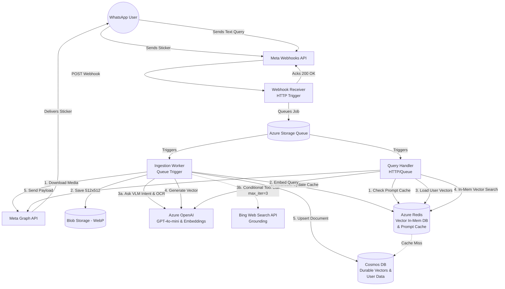

# Implementation Plan: WhatsApp Sticker Semantic Search Bot (Azure MVP)

## Goal Description
Implement a production-ready MVP for an event-driven WhatsApp bot that allows users to upload stickers, semantically indexes them using Multimodal AI (VLM + OCR), and lets users retrieve them later using natural language queries. The entire solution will be hosted on Azure using serverless components to minimize costs and scale efficiently.

---

## 1. SOTA Literature Review: Sticker & Meme Retrieval
Searching for stickers and memes is fundamentally different from standard image search because memes rely heavily on *cultural context, intent, and overlaid text*. You specifically asked if there is a "better model than an LLM for multimodal" given the need for web search to bypass knowledge cutoffs.

**The Reality of State-of-the-Art (SOTA):**
There is no single "non-LLM pure-vision" model that can natively search the web to understand deep cultural context. The current industry standard **is** an Agentic or Grounded Multimodal Large Language Model (MLLM).

1.  **Pure Visual Embeddings (e.g., CLIP, SigLIP):** 
    *   *Pros:* Fast, no intermediate text required.
    *   *Cons:* Entirely static. They cannot search the web, fail to understand cultural nuance, and lack reasoning capabilities to interpret new memes beyond their training data.
2.  **Grounded Multimodal LLMs (The Chosen SOTA Approach):** 
    *   *Architecture:* Using a Vision-Language Model (like GPT-4o) equipped with **Web Search Grounding**. 
    *   *How it works for Memes:* The VLM views the image, extracts initial text via OCR, and if it encounters a meme template or cultural reference it doesn't fully understand (or is past its knowledge cutoff), it formulates a query to a Search API (like Bing Web Search) to fetch real-time context before finalizing its description.
    *   *Why it's SOTA:* This natively solves the knowledge cutoff problem and provides the richest possible textual representation of the meme for downstream vector search.

**Conclusion:** We will stick with the VLM approach but augment `gpt-4o-mini` with **Bing Search Grounding** so it can research memes on the fly.

---

## 2. Azure Stack & Architecture Decisions

Based on your feedback, here is the finalized stack:

*   **Compute:** **Azure Functions (Python)**. 
    *   *Tier Analysis (Cold Starts vs Cost):* Python Functions experience "Cold Starts" (taking 2-5 seconds to boot) when waking up from 0 instances. Meta's WhatsApp Webhook requires an HTTP 200 OK response within 15 seconds. Because our HTTP trigger does absolutely no processing (it just drops the payload into a Storage Queue in <50ms and returns 200 OK), a 5-second cold start is completely safe and well within Meta's limits.
    *   *Decision:* We will use the **Consumption Plan (Y1)** for the MVP, which costs $0.00 and scales to zero. If the bot scales massively and requires strict VNet integration, we can upgrade later.
*   **Persistent Storage & Vector DB:** **Azure Cosmos DB for NoSQL**. 
    *   Will store user profiles, metadata, and the durable vector embeddings.
    *   *Domain Optimization:* Since stickers are **strictly per-user** and low-volume (~1,000 per user), the database will be heavily partitioned by `user_id`. Queries to Cosmos DB for a specific user's data will be extremely fast and cost-effective.
*   **Caching & Fast Retrieval:** **Azure Managed Redis**.
    *   *Prompt Caching:* Cache frequent LLM prompt completions to save Azure OpenAI costs.
    *   *In-Memory Vector DB:* Because a user only has ~1,000 vectors (which is tiny, <6MB), we can load their embedding matrix directly into Redis upon their first query. Subsequent queries by that user will execute lighting-fast cosine similarity in-memory using RediSearch.

---

## 3. Cost Estimation (Monthly, Low Traffic MVP)

Assuming ~1,000 ingestions and ~5,000 queries per month:

*   **Azure Functions (Consumption):** 1 million free grants. **$0.00**
*   **Azure Storage Account (Blob & Queue):** Standard LRS. **< $1.00**
*   **Azure Cosmos DB (Serverless):** Pay per RU. **~$5.00**
*   **Azure Managed Redis:** Depends on tier, memory optimized. **~$15.00 - $30.00**
*   **Bing Web Search API:** For grounding VLM. ~$3 per 1k transactions. **$3.00**
*   **Azure OpenAI (`gpt-4o-mini`):** Vision + Text (inc. OCR). ~0.3 cents per image. **~ $3.00**
*   **Azure OpenAI (`text-embedding-3-small`):** Negligible. **< $0.05**

**Total Estimated MVP Cost:** **~$32 - $50 / month.**

---

## 4. Overall System Design



---

## 5. User Interaction Flow (UX)

The bot elegantly differentiates between actions based on the native WhatsApp message type (`type: sticker` vs `type: text`):

**A. Ingestion Flow (Saving a Sticker)**
1. **User Action:** The user receives a funny sticker in a group chat and simply forwards it to the Bot's WhatsApp number.
2. **Webhook Event:** Meta sends a webhook payload with `messages[0].type = "sticker"`.
3. **Bot Acknowledgement:** The bot immediately marks the message as read (or optionally sends a quiet reaction emoji like ✅) so the user knows it was received.
4. **Background Processing:** The bot downloads the sticker, extracts text/intent, generates embeddings, and saves it to the user's private Cosmos DB partition.

**B. Retrieval Flow (Finding a Sticker)**
1. **User Action:** The user sends a normal text message to the bot (e.g., *"sad frog typing on a computer"*).
2. **Webhook Event:** Meta sends a webhook payload with `messages[0].type = "text"`.
3. **Search & Delivery:** The bot embeds the text, searches the user's isolated vector space natively in Redis (falling back to Cosmos DB if inactive), and replies directly to the user by sending back the matching sticker via the Meta Graph API.

---

## 6. Security & Observability

### A. Secrets Management
We will use **Managed Identity** (System Assigned) for almost everything (Azure Function -> Storage, Cosmos DB, Redis, and Azure OpenAI) to avoid hardcoded credentials. However, we *must* store three external API keys that do not support Microsoft Entra ID:
1. `META_GRAPH_TOKEN`: Long-lived access token for WhatsApp API.
2. `META_WEBHOOK_VERIFY_TOKEN`: Verification token for Meta webhook validation.
3. `BING_SEARCH_API_KEY`: Key for the Bing Web Search REST API.

These will be stored in **Azure Key Vault**, and the Function App will pull them securely at runtime using Managed Identity Key Vault References.

### B. Observability (Azure Monitor / Application Insights)
To ensure the bot operates reliably in production, we will configure the following in App Insights:
*   **Custom Metrics:** 
    *   *Cache Hit Rates (Viral vs Query)* to monitor Redis effectiveness.
    *   *VLM vs Web Search Ratio* to ensure our "System Prompt Leash" is keeping Bing Search usage < 5%.
    *   *End-to-End Latency* (Webhook receipt to Meta Graph API dispatch).
*   **Alerts:** 
    *   `DeadLetterQueue > 0`: Triggers if an ingestion job fails multiple retries, requiring developer intervention.
    *   `HTTP 5xx Rate > 1%`: Triggers if the webhook receiver is failing (which could cause Meta to pause our webhook subscription).

---

## Appendix: Architectural Justifications

### A. Why Storage Queues (vs. Event Grid or Service Bus)
*   **Zero Extra Infrastructure & Cost:** Since we already need an Azure Storage Account for Blob storage (to hold `.webp` files), utilizing its built-in Queues adds zero management overhead and costs a fraction of a cent per 10k transactions.
*   **Workload Match:** Ingestion tasks are completely independent. We do not require strict FIFO ordering, Pub/Sub topics, or complex event routing (which would necessitate Service Bus or Event Grid).
*   **Buffer Capability:** Unlike Event Grid (which pushes events), Storage Queues act as a deep buffer. If a user forwards 50 stickers simultaneously, the queue safely absorbs the spike, allowing the serverless Azure Function to scale up and process them reliably without overwhelming external APIs.

### B. Why Redis Caching Across User Scales
Given a limit of ~1,000 stickers per user, the vector payload per user is extremely small (~6 MB).
*   **100 Users (~600 MB):** Hitting Azure OpenAI for every text query adds 1-3 seconds of latency. Redis prompt caching makes common queries instant (<5ms) and avoids unnecessary OpenAI API costs.
*   **1,000 Users (~6 GB):** Serverless Azure Functions have limited memory constraints. We cannot load all users into a Python process. Azure Redis easily stores 6 GB in memory, executing vector similarity searches via RediSearch to completely offload compute from the Function app.
*   **10,000+ Users (~60+ GB):** Redis transitions to a True LRU Cache. Cosmos DB acts as the cheap, durable cold storage for all 60GB. When an active user sends a message, their specific 6MB profile is loaded into Redis with a 24-hour TTL, meaning we only pay for high-performance memory for actively querying users.

### C. Data Schemas (Cosmos DB & Redis)

To ensure high performance and strict per-user isolation, the data is modeled as follows:

#### 1. Cosmos DB (Durable Storage)
Cosmos DB for NoSQL serves as the source of truth. It is heavily partitioned to ensure queries for a user's library are isolated and cheap.
*   **Container:** `stickers`
*   **Partition Key:** `/userId` (WhatsApp Phone Number ID)
*   **Document Schema:**
    ```json
    {
      "id": "sticker_12345", 
      "userId": "15551234567",
      "blobUrl": "https://storage.blob.core.windows.net/stickers/12345.webp",
      "createdAt": "2026-09-28T22:00:00Z",
      "metadata": {
        "ocrText": "Happy Birthday",
        "memeTemplate": "Dog wearing a party hat",
        "mood": "Celebratory, joyful"
      },
      "embedding": [0.012, -0.045, 0.112, ...] // 1536-dimensional float array
    }
    ```

#### 2. Redis (RediSearch & Caching)
Azure Managed Redis acts as our vector search engine and prompt cache.

**A. User Vector Index (RediSearch)**
When an active user queries the bot, their Cosmos DB documents are loaded into Redis as Hashes to enable lightning-fast RediSearch vector similarity.
*   **Key Pattern:** `vector:{userId}:{stickerId}`
*   **Structure:** Redis `HASH`
*   **Fields:** 
    *   `vector`: Byte array (the 1536-dim embedding converted to raw bytes).
    *   `stickerId`: String.
*   **TTL:** 24 Hours (LRU eviction for inactive users).

**B. Global Image Extraction Cache (Viral Sticker Saver)**
*   **Key Pattern:** `img_extract:{sha256(webp_file_bytes)}`
*   **Structure:** Redis `STRING`
*   **Value:** JSON string containing the VLM output (Meme template, OCR text, mood).
*   **TTL:** 60 days.
*   *Why:* If 50 users upload the exact same viral sticker, we only pay the expensive Vision + OpenAI + Bing Grounding cost ONCE.

**C. Per-User Query Result Cache (Instant Re-use)**
*   **Key Pattern:** `user_history:{userId}`
*   **Structure:** Redis `HASH`
*   **Fields:** `{sha256(lowercase_query)}` -> `stickerId`
*   **TTL:** 7 days (refreshed on access).
*   *Why:* If a user searches for "lol" and selects a sticker today, they will likely search "lol" again tomorrow. This completely bypasses embedding generation and vector math for immediate retrieval.

### D. Cost Analysis: Custom Agent Harness vs Native Web Grounding
Processing a single sticker through `gpt-4o-mini` (Vision + Text) costs roughly **$0.00009**. A single call to the Bing Search API costs **$0.003**. Therefore, the search API is **~35 times more expensive** than the AI model. 

If we used Azure's built-in "Native Web Grounding" (which costs a premium $14/1k transactions), it could automatically search the web for nearly every image, causing the Search bill to constitute >95% of our ingestion costs.

To solve this, our Python `ingestion_worker.py` acts as a **Custom Agent Harness**. We expose a `search_web` function to `gpt-4o-mini` and control it with a strict "leash" using the following System Prompt:

> *"You are a meme extraction bot. Describe the image in detail. Extract the exact text written on the image, preserving all spelling errors and intentional slang. ONLY call the `search_web` tool if you encounter highly specific, novel internet slang, unknown public figures, or bizarre cultural references that you cannot confidently identify from your pre-training. For generic stickers, animals, common reactions, or standard memes (like Doge or Pepe), DO NOT search the web."*

**The Mathematical Tradeoff:**
By using this Agent Harness, the model realizes it already knows 95% of memes natively. It only triggers the expensive Search API on the 5% of stickers containing obscure, brand-new internet jokes. For 1,000 uploads, this drops our Search bill from an estimated $14.00 (Native) down to **$0.15** (Custom API calls), without sacrificing retrieval accuracy. (Note: A hard limit of `max_iterations=3` is enforced to prevent infinite loop billing traps).

### E. Cache Strategy: Tradeoffs & Invalidation
Every cache adds architectural complexity, which must be justified by cost or latency improvements. Furthermore, strict invalidation strategies are required to keep the user's data fresh.

#### 1. User Vector Index (The RediSearch Cache)
*   **Tradeoff:** Direct Cosmos DB vector search takes ~100ms and consumes high RUs, linking your DB bill to query volume. Redis cuts latency to **<5ms** and flatlines Cosmos DB costs, but trades this for a fixed baseline infrastructure cost for the Redis cluster.
*   **Invalidation (Targeted Update):** When a user uploads a new sticker, their Cosmos DB partition is updated. The Ingestion Worker checks Redis. If `vector:{userId}:*` exists (user is active), it executes `HSET vector:{userId}:{newStickerId}` to inject the new vector. If no keys exist, it does nothing. Passive eviction is handled by a 24-hour TTL.

#### 2. Global Image Extraction Cache (Viral Meme Cache)
*   **Tradeoff:** Invoking the VLM + Web Search API takes ~3.0s and costs ~$0.0031. Fetching this cache takes <5ms and costs $0.00. This is a mandatory cache; it requires virtually no memory and prevents viral spikes from bankrupting the project or exceeding API quotas.
*   **Invalidation (Pure TTL):** A meme's core visual description rarely changes. We do not actively invalidate this. We set a 60-day TTL; if the meme falls out of fashion, Redis passively drops it.

#### 3. Per-User Query Result Cache
*   **Tradeoff:** Since text embeddings are incredibly cheap ($0.02 per 1M tokens), this cache saves exactly **$0.00**. Its sole purpose is to shave **~200ms** off the response time for repeat queries by bypassing the OpenAI embedding call entirely. The tradeoff is added code complexity for aggressive invalidation.
*   **Invalidation (Aggressive Flush):** If a user searches "lol" today and gets a mediocre sticker, but uploads a perfect "lol" sticker tomorrow, their library fundamentally changes. Therefore, whenever a user uploads *any* new sticker, the worker executes a hard `DEL user_history:{userId}`. This guarantees their next search accurately scans their newly updated vector space.

### F. Testing Strategy
To maintain MVP velocity while ensuring reliability, testing will be highly targeted.

#### 1. Functional Testing (Minimal & Happy Path Only)
We will focus strictly on the core "happy path" user journeys. No exhaustive edge-case integration tests.
*   **Ingestion E2E:** Mock a Meta webhook sticker payload -> Verify the Function successfully drops it in the queue -> Verify the Ingestion Worker successfully extracts text via OpenAI and writes the document to Cosmos DB.
*   **Retrieval E2E:** Mock a Meta webhook text payload -> Verify the Query Handler successfully queries Redis/Cosmos DB and generates the correct Meta Graph API outbound POST request.

#### 2. Unit Testing (Scenario-Based)
Instead of enforcing arbitrary line-coverage metrics or testing every single helper function, unit tests will strictly validate complex business scenarios:
*   **Agent Harness Tool Calling:** Ensure the Python parsing logic correctly identifies when `gpt-4o-mini` requests a `search_web` tool call versus when it returns a standard description.
*   **HMAC Signature Validation:** Verify the webhook receiver correctly rejects invalid Meta payloads to ensure security.
*   **Cache Invalidation Logic:** Assert that the `user_history:{userId}` Redis key is explicitly deleted when a new sticker ingestion is simulated.

### G. CI/CD Strategy (Post-MVP)
A fully automated CI/CD pipeline (e.g., GitHub Actions or Azure DevOps) is explicitly **out of scope for the MVP** to prioritize speed of initial delivery. Deployment will initially be handled manually via the Azure CLI / Antigravity tools. 

Once the MVP proves viability, the pipeline will be configured with the following testing cadence:
*   **Unit Tests:** Triggered on *every Pull Request* to ensure immediate feedback on business logic regressions.
*   **Functional (Happy Path) Tests:** Triggered automatically on merges to the `main` branch and executing against a staging environment (hitting a Dev Cosmos DB) prior to a production swap. This ensures the core ingestion and retrieval loops are never broken before code reaches live users.

### H. Proposed Code Architecture
The detailed breakdown of files to be generated during implementation.

#### 1. Infrastructure Definition (Bicep)
The infrastructure will be modularized for maintainability. A root `main.bicep` will orchestrate the deployment of the following component modules:
*   `modules/storage.bicep`: Storage Account (Blob container for `.webp` and Queues).
*   `modules/compute.bicep`: Azure Function App (Consumption, Python), App Service Plan, and Application Insights.
*   `modules/ai.bicep`: Azure OpenAI (VLM & Embeddings) and Bing Search API.
*   `modules/database.bicep`: Azure Cosmos DB for NoSQL (Serverless) configured for vector search.
*   `modules/cache.bicep`: Azure Managed Redis instance.
*   `modules/security.bicep`: Managed Identity role assignments ensuring the Function App can securely access all other resources without connection strings.

#### 2. Application Code (Python)
*   `host.json`: Configures the Azure Functions runtime, including Application Insights log sampling rates and minimum log levels.
*   `requirements.txt`: Includes `azure-functions`, `azure-cosmos`, `redis`, `openai`, `azure-monitor-opentelemetry`, and `tenacity` (for exponential backoff and rate-limit handling on raw HTTP calls).
*   `function_app.py`: Main entry point for v2 Python programming model. Initializes the OpenTelemetry exporter for App Insights.
*   `src/webhook_receiver.py`: Handles Meta Verification (`hub.challenge`) and HMAC Signature validation. Pushes raw payload to `incoming-stickers` or `incoming-queries` queues.
*   `src/ingestion_worker.py`: Downloads `.webp`, uploads to Blob. Implements a Custom Agent Harness using Tool Calling with `gpt-4o-mini` (hardcapped to `max_iterations=3`) to conditionally search Bing only for unknown memes. Embeds the final description, pushes to Cosmos DB, and invalidates/updates the Redis vector cache. Uses `tenacity` decorators to gracefully retry on Meta API or Bing API rate limits. Emits custom metrics via telemetry.
*   `src/query_handler.py`: Embeds user text, checks Redis for cached user vectors (falling back to Cosmos DB). Executes the vector similarity search in Redis and posts back to Meta Graph API (with `tenacity` backoff). Emits `CacheHit` metrics.

### I. Pre-runtime Checks & Code Quality
To catch bugs before they ever reach the Azure Function runtime, we will enforce strict Python best practices locally:

1. **Linting & Formatting (`ruff`):** We will use `ruff` to act as an ultra-fast drop-in replacement for both `flake8` (linting) and `black` (formatting). It ensures PEP-8 compliance and catches unused imports or undefined variables.
2. **Static Type Checking (`mypy`):** The codebase will be fully type-hinted. `mypy` will run to statically verify that functions are passing the correct data types, preventing classic `TypeError` exceptions during webhook ingestion.
3. **Automated Enforcement (`pre-commit`):** We will implement a `.pre-commit-config.yaml` file. Every time a developer attempts to `git commit`, the pre-commit hook will automatically run `ruff` and `mypy`. The commit will be blocked if any pre-runtime checks fail.
